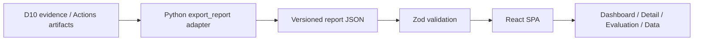

# React 확장 설계 — D11~D20

기존 분석·댓글·Discord 파이프라인을 변경하지 않는 읽기 전용 확장입니다.

UI는 Graphite 테마, 상태 배지·테이블·탭·코드 뷰어를 사용합니다. 브라우저에는 토큰·키·Webhook을 전달하지 않습니다. 파일 내용은 React 문자열로 표시하며 HTML 실행을 하지 않습니다. import는 5MB/1,000건 상한, 버전/상태/필수 필드/외부 URL 검증 후 기존 데이터를 원자적으로 교체합니다. 실패 시 기존 데이터는 유지합니다. localStorage나 서버 업로드는 사용하지 않습니다.

공개 demo.json은 실제 합성 6쌍의 측정 수치를 보존하되 원본 코드·로그·저장소·SHA·링크를 제거합니다. 익명화 후 위치 배지는 미확인으로 표시해 가상의 파일을 검증된 근거라고 주장하지 않습니다. 실제 import의 위치 링크는 commit SHA에 고정합니다. 위치 유효성과 내용 판정은 별개입니다.

D10은 PR 제목과 세부 단계별 시간·실패 이유를 모두 저장하지 않았습니다. 제목은 사례 ID로 대체하며, 원본에 없는 시간·이유는 미측정/없음으로 표시합니다. 실행 생성~댓글 시간은 PR 이벤트~게시의 정확한 지연이 아닙니다. 평가 지표는 표본 6쌍의 측정값만 사용합니다.

초기 배포는 정적 SPA이며 Vercel의 web 루트 설정 또는 정적 호스팅으로 가능합니다. SPA fallback이 필요합니다. 브라우저에서 LLM이나 인증 GitHub API를 호출하지 않습니다. 실제 비공개 결과 파일을 공개 정적 디렉터리에 복사하지 않습니다.
